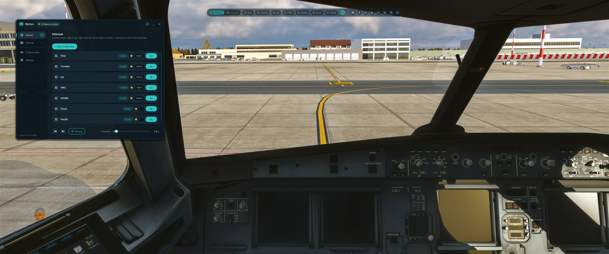
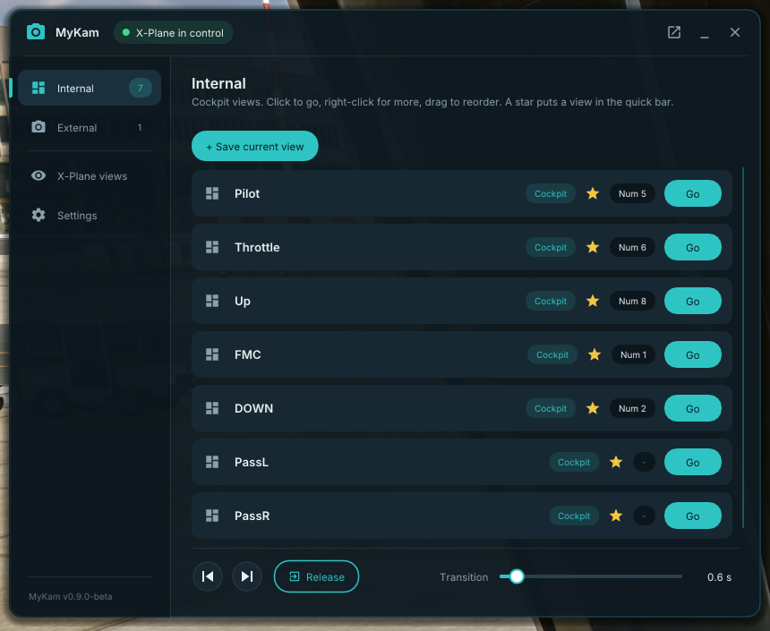
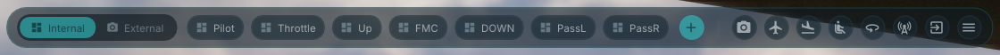

# MyKam

Saved cameras with smooth transitions for X-Plane 12.



MyKam is a plugin for X-Plane 12 on Windows. Save the view you are looking at, in the cockpit or outside the
aircraft, and come back to it with one key or one click. Switching glides from where the camera is to the
saved view with an eased move instead of a cut.

**Status: beta (0.9.2-beta).** It has had little testing outside the developer's own setup. See
[Known limitations](#beta-status-and-known-limitations).

## What it does

- **Saved views per aircraft.** Up to 99 per aircraft, kept in a small text file next to the aircraft's `.acf`.
- **Cockpit and outside views.** Cockpit views store the pilot's head position and angles. Outside views store a
  camera pose relative to the aircraft, so the camera follows the aircraft when it moves and banks.
- **Smooth, eased transitions.** 0 to 10 seconds (default 1.5). Heading takes the short way round, and a new
  switch while one is running continues from where the camera is.
- **Hand-off to X-Plane.** After an outside move, MyKam can hand the camera to the X-Plane view the view was saved
  in (chase, circle, tower and so on), to X-Plane's free camera, or keep holding it with its own mouse and key control.
- **Internal and External groups.** Cockpit views are listed under Internal, free camera and chase views under External.
- **Quick bar.** A slim bar on the screen with the starred views of the shown group, a switch between the groups,
  buttons for X-Plane's own views, Release and Menu.
- **Labels.** One or two letters or digits on a view's chip in the quick bar.
- **Custom keys.** Give a view any key (with Shift, Ctrl and Alt) or one of the numpad slots 0 to 9.
- **On / off.** One key (`mykam/toggle_active`) turns MyKam off completely and back on.
- **X-Plane view buttons.** Cockpit, free camera, chase, circle, tower, runway, linear spot, still spot,
  ride-along and wingman, in the window and on the quick bar.
- **Mouse and keys while MyKam holds an outside camera.** Right-drag orbits the aircraft, the wheel moves closer
  or farther, and X-Plane's view movement keys move the camera.

## Screenshots

The MyKam window on the Internal page, with seven saved cockpit views and the quick bar at the top of the screen:



The quick bar: switch between Internal and External, starred views, save the current view (+), X-Plane view
buttons, release and the menu:



## Install

1. Quit X-Plane 12.
2. Download `MyKam-0.9.2-beta-win64.zip` from the [Releases page](https://github.com/dmenditto/MyKam/releases)
   or from [X-Plane.org](https://forums.x-plane.org/files/file/102414-mykam-saved-cameras-with-smooth-transitions/),
   and unzip it.
3. Copy the `MyKam` folder into `<X-Plane 12>\Resources\plugins\`. You should end up with:
   - `Resources\plugins\MyKam\win_x64\MyKam.xpl`
   - `Resources\plugins\MyKam\mykam.ini`
   - `Resources\plugins\MyKam\fonts\`
   - `Resources\plugins\MyKam\skunkcrafts_updater.cfg`
4. Start X-Plane 12. Open **Plugins > Plugin Admin** and check that **MyKam** is listed and enabled.

If you use another camera plugin, disable it while you try MyKam. When X-Camera is enabled, MyKam shows an amber
note in its window (and a line in Log.txt): X-Camera can move the camera back after MyKam moves it.

**XPRealistic.** When XPRealistic is installed, each view's edit dialog has an XPRealistic choice: *Leave as is*,
*On* or *Off*. Off pauses XPRealistic's effects when you go to that view (for a still shot), On resumes them
(after a cockpit glide has ended, so the head does not shake during the glide). XPRealistic's master switch is
left to you.

### Updates

MyKam can be kept up to date with [SkunkCrafts Updater](https://updater.skunkcrafts.com/). Install the updater
once, run it with X-Plane closed, and MyKam appears in its list (it finds `skunkcrafts_updater.cfg` in the MyKam
folder). It downloads only the files that changed. Your `mykam.ini` and your saved views are never replaced.
You can also update by hand: download the new zip and copy the `MyKam` folder over the old one.

## First steps

1. Load an aircraft and pick a view you want to keep: a cockpit view (for example look at the left window), or an
   outside view (the free camera or the chase view, placed where you like).
2. Open **Plugins > MyKam > Show window**.
3. On the **Internal** page (cockpit) or **External** page (outside) click **+ Save current view**. MyKam gives the
   view a default name. Right-click a view to rename it, give it a label or a key, or star it so that it shows in
   the quick bar.
4. Click a view, or its chip in the quick bar, to go to it. **Release** gives the camera back to X-Plane.

The window is hidden every time X-Plane starts. Bind `mykam/toggle_window` to a key to open and close it quickly.
The complete guide to the window and the quick bar is in [docs/UI-GUIDE.md](docs/UI-GUIDE.md).

## Key binding

MyKam registers X-Plane commands. Bind them in X-Plane under **Settings > Keyboard** (type `mykam` in the search box).
Suggested keys: go to a view on Numpad 0 to 9, save on Ctrl + Alt + Numpad 0 to 9, turn MyKam on and off on Numpad . (decimal point).
A view can also have its own **custom key** in its edit dialog; MyKam registers that key with X-Plane itself.

The slot cards in the window show key hints taken from `key_hint_go` and `key_hint_save` in `mykam.ini`. They are
only labels. The real keys are the ones you bind in X-Plane.

## Commands

| Command | What it does |
|---------|--------------|
| `mykam/go_slot_0` ... `mykam/go_slot_9` | Go to the view that has numpad slot N. |
| `mykam/save_slot_0` ... `mykam/save_slot_9` | Save the current view into the view that has slot N, or create one. |
| `mykam/release` | Give the camera back to X-Plane. |
| `mykam/toggle_active` | Turn MyKam on or off. Off gives the camera back to X-Plane, hides the window and the quick bar, frees the custom keys and ignores every go and save until it is turned on again (also Plugins > MyKam > MyKam on). |
| `mykam/toggle_window` | Show or hide the MyKam window (showing it also turns MyKam on). |
| `mykam/next` | Go to the next saved view (Internal, then External). |
| `mykam/previous` | Go to the previous saved view. |
| `mykam/toggle_group` | Switch the quick bar between the Internal and External lists. |

## Where files are stored

| File | Where | What |
|------|-------|------|
| `mykam.ini` | `Resources\plugins\MyKam\` | Settings: transition time, hand-off, quick bar. Written by the Settings page, which keeps your comments and other lines. |
| `mykam_views.txt` | The aircraft's own folder, next to its `.acf` | The saved views of that aircraft. |
| `Log.txt` | The X-Plane folder | X-Plane's log. MyKam lines start with `[MyKam] `. |

MyKam writes nothing else.

## Uninstall

Quit X-Plane and delete `Resources\plugins\MyKam`. The `mykam_views.txt` files in your aircraft folders can stay or
be deleted. Nothing else is changed.

## Build from source

You need Windows 10 or 11 and Visual Studio 2022 or the Visual Studio 2022 Build Tools with the
"Desktop development with C++" workload. Everything else (the X-Plane SDK, Dear ImGui, doctest, the fonts) is in `third_party/`.

```
msbuild MyKam.sln /t:Rebuild /p:Configuration=Release /p:Platform=x64 /m /nologo /v:m
```

The plugin is written to `build\MyKam\win_x64\MyKam.xpl`, with `mykam.ini` and `fonts\` next to it
(`build\MyKam` is the plugin folder). Warnings are errors.

Run the unit tests:

```
build\tests\Release\mykam_tests.exe
```

Build, test and make the release zip in one go:

```
powershell -ExecutionPolicy Bypass -File tools\package.ps1
```

This creates `dist\MyKam-0.9.2-beta-win64.zip` and stops if the build or any test fails.

To publish that version for SkunkCrafts Updater users, commit the release and run
`tools\publish-depot.ps1 -Push`. It builds the depot (every file of the zip's `MyKam` folder plus the CRC32
and size lists) and pushes it to the `gh-pages` branch, served by GitHub Pages at
`https://dmenditto.github.io/MyKam/updater/MyKam`. Without `-Push` it only builds `dist\depot` to look at.
`deploy.ps1` never copies `skunkcrafts_updater.cfg`, so the updater leaves a development install alone.

To copy a build into your X-Plane while developing, run `deploy.ps1 -XPlanePath "<your X-Plane 12 folder>"`
(or set the `XPLANE12_PATH` environment variable). Quit X-Plane first. See [CONTRIBUTING.md](CONTRIBUTING.md).

The manual in-sim test scripts are in [docs/TESTING-IN-XPLANE.md](docs/TESTING-IN-XPLANE.md) and
[docs/TESTING-NUMPAD.md](docs/TESTING-NUMPAD.md).

## Beta status and known limitations

- **Windows 64-bit only.** The plugin is built for Windows. It is untested on Linux and macOS and has no build for them.
- **VR is untested.** The windows are drawn on the flat screen.
- **Custom keys may conflict with X-Plane key bindings.** X-Plane does not tell plugins which keys it uses, so a
  custom key that is also bound in X-Plane may stop that X-Plane binding from working while MyKam uses it.
- Saving is refused in X-Plane's circle, tower, runway, spot, ride-along and wingman views, because X-Plane places
  those cameras itself. Save from a cockpit view, the free camera or the chase view.
- Another plugin that controls the camera at the same time can take it away from MyKam.
- This is a beta: file formats and behaviour may still change before 1.0.

## Reporting issues

Please open an issue on the project's GitHub page using the bug report template. It asks for your X-Plane version, the
MyKam version, the aircraft, the steps, and the `[MyKam]` lines from `Log.txt`. The log lines make most problems
much quicker to find.

## Licence

MyKam is released under the [MIT licence](LICENSE). It includes third-party components under their own licences:
see [THIRD_PARTY_NOTICES.md](THIRD_PARTY_NOTICES.md). MyKam is an independent project; it is not made, approved or
supported by Laminar Research, and "X-Plane" is a trademark of its owner.
